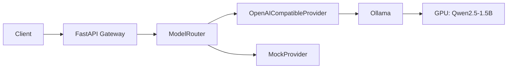

# MiniTokenFactory 架构说明

更新日期：2026-11-26。依据当前工作区实现核对，应用版本为 `0.2.0`。项目实现推理网关与后端适配层，实际模型计算由 Ollama 及其推理后端执行。

## 模块与数据流

真实链路是 Client → Gateway → Router → Provider → Ollama → GPU，响应沿相反方向返回。MockProvider 不访问 GPU。

| 模块 | 职责 |
|---|---|
| `app/main.py` | create_app、Lifespan、共享资源初始化与关闭 |
| `app/api/schemas.py` | Pydantic 请求、非流式响应及模型列表结构 |
| `app/api/routes.py` | HTTP 路由、限流、并发控制、异常映射、SSE 转发 |
| `app/services/router.py` | 模型别名注册、查找 Provider、分派普通及流式调用 |
| `app/services/rate_limiter.py` | 进程内 Token Bucket |
| `app/providers/base.py` | Provider 抽象、流式接口及上游异常类型 |
| `app/providers/openai_compatible.py` | HTTPX 调用、模型名映射、JSON/SSE 处理 |
| `app/providers/mock.py` | 模拟普通响应与 SSE 事件 |

当前注册 `mock-chat` 与 `qwen-model`；后者映射到 `qwen2.5:1.5b`，默认上游地址为 `http://127.0.0.1:11434/v1`。Router 按名称查表，未实现动态负载均衡或推理引擎内部调度。

## Pydantic 校验与 JSON 转换

FastAPI 将请求 JSON 解析为 ChatCompletionRequest。Schema 要求 model 非空、messages 至少一条、role 为 system/user/assistant、temperature 在 0 到 2 之间、max_tokens 为正数，stream 默认为 false。校验失败由 FastAPI 返回 422；content 当前仅要求字符串，没有非空约束。当前支持范围以 Schema 为准，不代表完整 OpenAI API 参数兼容。

Provider 将每条消息通过 `model_dump()` 转为字典，替换模型名，构建 model/messages/temperature/max_tokens/stream payload，再以 HTTPX `json=payload` 序列化发送。

非流式调用共享客户端 `post()`，先 `raise_for_status()`，再 `response.json()`。Provider 检查顶层为对象，恢复响应中的 Gateway 模型别名，并以 `ChatCompletionResponse.model_validate()` 校验结构。usage 来自上游，Mock usage 为零占位，Gateway 没有独立 Tokenizer。

| 异常 | 响应头发送前的 HTTP 处理 |
|---|---|
| 未知模型 | 404 |
| Provider 不支持所请求的调用方式 | 400 |
| 上游超时 | 504 |
| 上游连接失败、HTTP 错误、JSON/Schema 错误 | 502 |
| 令牌桶拒绝 | 429 |

## Lifespan 与共享 AsyncClient

Lifespan 在 `async with httpx.AsyncClient(...)` 中创建共享客户端，注入 OpenAICompatibleProvider，并将客户端、Router、Semaphore、TokenBucket 保存到 app.state。每次推理复用客户端和连接池，Provider 不拥有客户端关闭权；应用退出 Lifespan 时统一关闭。

当前代码配置：连接池上限 20、保活连接上限 10、保活 30 秒，connect/read/write/pool 超时分别为 5/30/10/5 秒。这些是 HTTP 配置，连接数不等于推理并发能力，read 超时不是整个请求的总时限。

create_app 支持注入 upstream_transport；测试以 MockTransport 构造成功、失败和流式响应。这些测试验证调用链与适配逻辑，不构成真实 Ollama/GPU 推理证据。

## SSE 转发与释放

1. 流式请求通过令牌桶后获取 Semaphore 名额，由 Router 返回异步流。
2. 路由在返回 StreamingResponse 前通过 `anext(stream)` 预读首事件，使首事件前的上游 HTTP/解析错误仍可转换为 HTTP 错误。首事件可能只有角色字段，不一定包含生成文本。
3. Provider 在 `async with client.stream(...)` 内使用 `aiter_lines()` 读取上游，空行划分 SSE 事件，收集多行 data 字段。
4. JSON 事件检查 object 为 chat.completion.chunk、choices 为列表，恢复模型别名后重新编码转发。该路径不是字节级透传，也没有对所有增量字段执行完整 Pydantic 校验。
5. 收到 [DONE] 后转发结束标记；上游缺少 [DONE]、非法 JSON 或基本结构异常时抛出 ProviderResponseError。

StreamingResponse 设置 text/event-stream、Cache-Control: no-cache、X-Accel-Buffering: no。响应头发送后的错误无法再改变 HTTP 状态码，当前也没有统一流内错误事件封装，客户端应检查结束标记。

路由流生成器的 finally 调用 `stream.aclose()`，然后释放 Semaphore；预读空流、预读失败及预读取消也有清理路径。Provider 退出 HTTPX stream 上下文时关闭本次上游 Response，不关闭共享 AsyncClient。流式名额在整个转发期间保持占用。

代码未显式轮询 request.is_disconnected()；客户端中断处理依赖 ASGI/StreamingResponse 的取消或关闭行为及上述清理逻辑。`tests/test_upstream_streaming.py` 的提前停止测试通过显式 aclose 验证 Response 被关闭、共享客户端仍存活。真实网络断开后取消是否总能及时传到 Ollama 并停止 GPU 计算，仍待专项端到端验证，不能据该测试作完整保证。

## Semaphore 与 Token Bucket 的职责

| 机制 | 控制内容 | 当前默认配置 |
|---|---|---|
| Semaphore | 同时执行推理/流式转发的请求数；不足时等待 | 最大 2 |
| Token Bucket | 请求准入速率与突发量；余额不足立即 429 | 每秒补充 20，容量 100 |

TokenBucket 使用单调时钟补充余额、asyncio.Lock 保护更新，每个获准聊天请求消耗一个令牌。这里的令牌是请求配额，与模型 Token 无关。准入检查发生在获取 Semaphore 和查询具体模型之前，通过后失败的请求也已消耗配额。`/health` 与 `/v1/models` 不经过聊天路由中的两项控制。

两者均为应用实例内资源，多进程不共享全局限额。Semaphore 不设置 Ollama 的并行序列数；2026-11-26 实验中 Gateway 上限为 2，Ollama OLLAMA_NUM_PARALLEL=1。客户端并发 4 包含排队，不能称为 GPU 原生四路并行。

## 实现边界与证据

当前已实现网关、真实上游接入、SSE、共享异步客户端、请求并发及速率控制。尚未实现自研推理引擎、CUDA Kernel 优化、PagedAttention 或自研 Continuous Batching；GPU Offload、Flash Attention 和 KV Cache 类型属于 Ollama 后端配置实验。

本地自动化测试覆盖见 README；测试目录当前被 Git 忽略。实验口径与原始记录出处见 [Benchmark 报告](benchmark_report.md)，GPU 配置及待验证事项见 [GPU 报告](gpu_optimization_report.md)。
